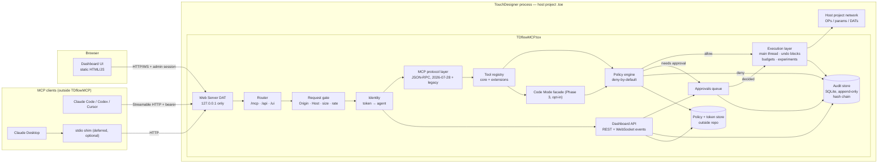

# System design

**Status: Proposed.** Nothing in this document is implemented (see [current-state](../icm/current-state.md)). Component choices are backed by **Proposed** ADRs [0002](../decisions/0002-in-process-mcp-host.md)–[0007](../decisions/0007-source-first-build.md) awaiting owner approval.

## 1. Component diagram



ASCII fallback:

```
 MCP client ─┐                         ┌──────────── TDflowMCP.tox (inside TouchDesigner) ───────────┐
 Dashboard ──┼─HTTP 127.0.0.1──▶ Web Server DAT ─▶ Router ─▶ Gate(Origin/Host/size) ─▶ Identity      │
 (stdio shim)┘                         │                                  │                          │
                                       │            /mcp ◀────────────────┤──────▶ /api, /ui        │
                                       │  MCP layer ─▶ Tool registry ─▶ Policy engine ─┬─deny──▶ Audit│
                                       │                    ▲                          ├─approve─▶Queue│
                                       │       Code Mode facade (opt-in)               └─allow─▶ Exec │
                                       │                                   Exec(main thread, undo) ─▶ Host network
                                       └──────────────────────────────────────────────────────────────┘
```

## 2. Components

| Component | Responsibility | Key constraints |
|---|---|---|
| **Web Server DAT** | Single listener for MCP, dashboard API and static UI | `localaddress=127.0.0.1`. The effective loopback-only bind is verified at start, and the component refuses to start otherwise. Port configurable (proposed default 9480) |
| **Router + gate** | Path routing. Rejects bad `Origin`/`Host` (403), oversized bodies (413) and malformed JSON (400) **before** any TD access | Per spec, Origin validation is mandatory |
| **Identity** | Maps `Authorization: Bearer <token>` to an agent record (id, name, role, enabled). Dashboard uses a separate admin session | Tokens stored hashed (SHA-256 + per-token salt), compared with `hmac.compare_digest` |
| **MCP protocol layer** | JSON-RPC 2.0 parsing. Supports spec 2026-07-28 (stateless, per-request `_meta`, `MCP-Protocol-Version`/`Mcp-Method`/`Mcp-Name` header checks) and the legacy `initialize` flow (2025-11-25) | Hand-rolled ([ADR-0003](../decisions/0003-protocol-implementation.md)). Validation by bundled `jsonschema` |
| **Tool registry** | Declarative tool definitions: name, schema, annotations, **required actions**, **target resolver**, handler | Extensions register through the same contract ([§5](#5-extension-contract)) |
| **Policy engine** | Pure-Python, TD-independent. Evaluates `(agent, action, resolved targets, tool, args)` → `allow` / `deny(reason)` / `require_approval(rule)` | Deny by default. Unit-testable outside TD. See [security model](security-model.md) |
| **Approvals queue** | Holds pending calls. Exposes them to the dashboard. Resumes or rejects them | Non-blocking (see §4) |
| **Execution layer** | Runs handlers on TD's main thread. Wraps mutations in `ui.undo.startBlock/endBlock`. Enforces time/size budgets. Captures results and errors | Never touches OPs off the main thread ([Thread Manager](https://docs.derivative.ca/Thread_Manager)) |
| **Experiments** (Phase 3) | Creates an isolated child COMP (or copy) where an agent has a relaxed grant. Promote or discard | Scope is the experiment root only |
| **Code Mode facade** (Phase 3) | Optional `tdflow_execute_script`, where the script calls a curated `tdflow` API whose every call goes through the policy engine | Not a sandbox ([ADR-0004](../decisions/0004-code-mode-strategy.md)) |
| **Audit store** | Append-only SQLite (`sqlite3` is bundled). `intent` + `outcome` events per executed call, `deny` events, and aggregated auth failures, all hash-chained with keyed checkpoints | Stored outside the repo and outside the `.toe` ([ADR-0006](../decisions/0006-audit-store.md)) |
| **Dashboard API + UI** | REST for sessions, audit, policy, tokens and approvals. WebSocket push of events. Static UI with no build step | Same-origin only. Admin session required ([ADR-0005](../decisions/0005-dashboard.md)) |

## 3. Request lifecycle (MCP `tools/call`)

1. Web Server DAT `onHTTPRequest` receives a POST to `/mcp`.
2. Gate: Host is loopback, Origin is absent or allow-listed, body ≤ limit, `Content-Type` is JSON. Otherwise 400/403/413, logged as `gate_reject` (rate-limited logging).
3. Identity: resolve the bearer token. Missing or invalid → 401 + audit `auth_fail`.
4. Protocol: parse JSON-RPC, check the protocol version header against the body, and route the method.
5. Registry: find the tool, then validate arguments against its input schema.
6. Target resolution: the tool's resolver turns arguments into a list of **absolute, normalized operator paths** plus actions. Parent paths count for `create`, and both source and destination paths count for wiring.
7. Policy: evaluate every `(action, path)` using the [action classification](security-model.md#33-action-classification-of-tool-effects-security-critical). Any deny → tool error (`isError: true`, reason code) plus a `deny` audit event. Approval needed → pending result (§4).
8. Audit `intent` event. If the store is unavailable, fail closed.
9. Execute on the main thread inside an undo block, with cooperative budget checks ([security model §7](security-model.md#7-resource-limits-cooperative)).
10. Audit `outcome` event (result, duration, undo label, chain hash), then push it to dashboard subscribers.
11. Respond with a JSON-RPC result (`content` + `structuredContent`).

## 4. Approvals without blocking TouchDesigner

The Web Server DAT callback runs inside TD. Whether it can defer a response is **unverified** (Phase 1 spike). The proposed design must not block the cook thread waiting for a human:

- If policy returns `require_approval`, the server records a pending call (canonical args digest, agent, resolved targets, policy version, expiry) and responds immediately with a non-error result: `{"status":"pending_approval","approval_id":"…","expires_at":…}`.
- The human approves or rejects in the dashboard, which shows the full raw arguments.
- The agent may poll `tdflow_approval_status(approval_id)` (read-only). **Execution happens only when the agent repeats the identical call** with `_meta.tdflow.approval_id`. At that point the server re-resolves the targets, re-evaluates policy, and consumes the approval. The full rules are in [security model §4](security-model.md#4-approvals).
- **Phase 1 has no approval surface**, so `require_approval` resolves to deny (`APPROVAL_UNAVAILABLE`).
- On spec 2026-07-28 clients, MRTR `InputRequiredResult` may later replace polling. This is deferred until the spike confirms client support.

## 5. Extension contract

Extensions (visual analysis, debugging, optimization, multi-agent coordination) live in `src/extensions/<name>/`. That is outside the `td`-free core because many of them (e.g. TOP capture) need `td`, which they reach only through `src/td_adapter/`. They register tools through the same registry API:

```python
# proposed shape — not implemented
@tool(name="tdflow_x_capture_top", actions={"read"}, targets=arg_path("path"),
      annotations={"readOnlyHint": True}, budget_ms=200)
def capture_top(ctx, path: str, max_px: int = 512) -> ToolResult: ...
```

Rules: an extension cannot bypass the policy engine, register routes outside `/mcp`, or access tokens. Extensions are disabled until enabled in policy. Multi-agent features (leases/claims on scopes) build on agent identity and audit.

## 6. Threading and performance (proposed budgets — hypotheses)

- All TD object access happens on the main thread. Pure-Python work (JSON parsing, policy evaluation, hashing) also runs there in Phase 1 for simplicity. Measure before moving anything to the Thread Manager.
- Targets (Phase 1, to be measured; hypotheses, not guarantees): p95 server overhead ≤ 5 ms per read call excluding the handler, and a response size cap of 1 MiB (configurable, enforced). The per-call time budget for core tools is 250 ms, enforced **cooperatively** (checked between steps, and overruns are flagged). TD's main thread cannot pre-empt Python, so a runaway handler or script cannot be interrupted ([security model §7](security-model.md#7-resource-limits-cooperative)).
- Large operations (big networks, captures) must paginate or chunk.

## 7. Deployment

- **Distribution:** one `TDflowMCP.tox` plus `TDflowMCP.json` (version, sha256), built from `src/` ([ADR-0007](../decisions/0007-source-first-build.md)).
- **Runtime state** (tokens, policy, audit DB): per-user directory `%LOCALAPPDATA%\TDflowMCP\<project-id>\` on Windows (macOS equivalent TBD). Never stored in the `.toe`, the `.tox` or Git.
- **Client setup:** prefer environment-variable expansion so the token never lands in a committed file, e.g. a user-scope entry with `--header "Authorization: Bearer ${TDFLOW_TOKEN}"` (verify the client's env-expansion support in Phase 1). Tokens are never auto-written into repo files such as `.mcp.json`.
- **Claude Desktop** cannot send static bearer headers to remote servers without a bridge. It is supported only after the deferred stdio shim or OAuth lands. Phase 1 targets Claude Code (and other header-capable clients).
- **Compatibility:** the `.tox` is built and tested on the declared minimum TD build ([ADR-0007](../decisions/0007-source-first-build.md)), because a `.tox` saved in a newer build may not load in older ones.
