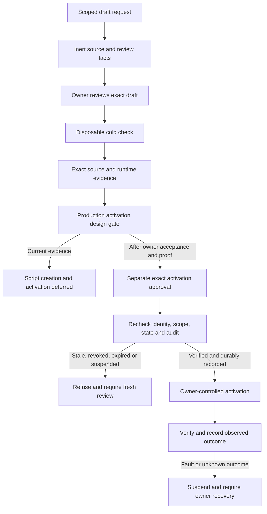
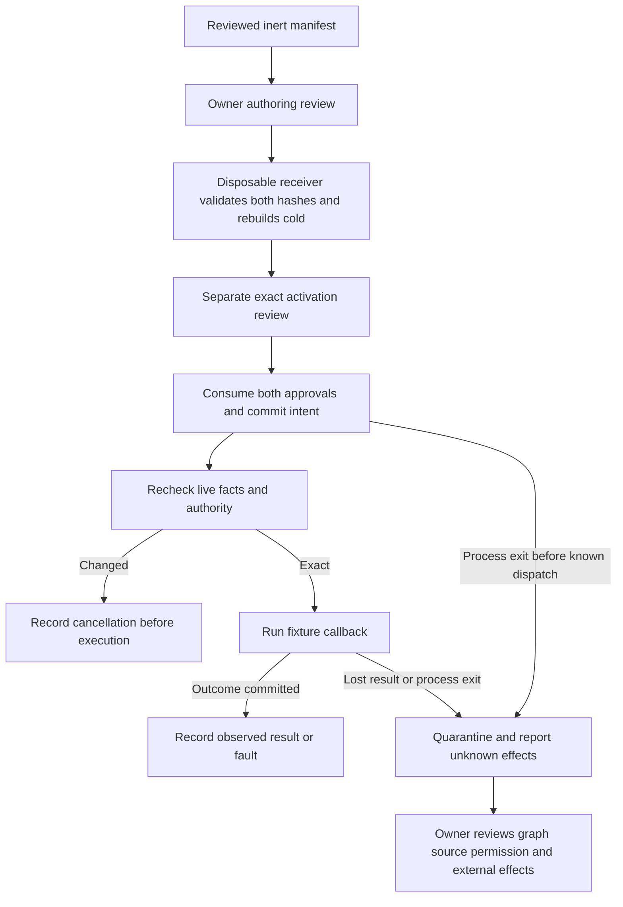

# TDflowMCP v1.7 Advanced Script Access research

[Issue #20](https://github.com/jlopesmo/TDflowMCP/issues/20) authorizes disposable research after the verified v1.6 release. The production decision remains proposed. [ADR-0018](../decisions/0018-script-operator-lifecycle.md)

## Trust boundary

Drafts contain inert source bytes, a declared target, callback association and static input references. Parse source for syntax and review hints without loading Python modules or linking a draft DAT to a live Script operator. Import names may help an owner review a draft. They cannot establish what Python will do at runtime.

Proposed Advanced Script Authoring starts off. The owner can issue separate, expiring permissions for source authoring and activation, bound to one agent, project and exact component scope. An existing Builder or Operator role or a general execute grant cannot issue either permission. The owner reviews each exact source authoring action. A separate activation decision would require the accepted execution design and a fresh preview of the exact runtime state.

The preview binds code bytes and source hash, exact Script and selected callback DAT identities, callback mode, script family, input and output port associations, parent identities and cook state, bypass and trigger settings, executable dependencies, runtime build and epoch, actor, grant expiry, and policy version. A dispatch would serialize target mutations, re-resolve all facts and check current policy, revocation, expiry, protected resources and suspension. It would then durably record and consume the exact owner approval before any native action. A stopped or restarted runtime requires fresh approval.

Approved Python runs with the host process's access to files, network, native libraries and GPU resources. Its effects can extend beyond the authorized operator scope. An ordinary second TouchDesigner process under the same user account does not establish isolation from those resources. The owner would control transfer into a real project. The installed build has no verified production Script activation or automatic transfer path.

## Proposed state transitions

## Threat model

| Threat | Required control | Evidence or open gate |
| --- | --- | --- |
| A read, setup pulse, viewer, input change or initialization triggers execution before activation | Keep source outside an executable graph until the transition is proven. Audit known triggers on each supported runtime. | A cook-disabled parent still allowed the Setup Parameters action to advance all three cook counts. |
| A docked DAT looks like the callback while another DAT runs | Verify the selected authored Text DAT's runtime identity and exact source. Refuse dynamic, wired and external source. | Selecting a same-text alternate changed the intent and left the factory DAT docked. |
| Stale, replayed or cross-project approval authorizes different inputs or source | Bind exact targets, topology, state, runtime, scope, expiry and policy. Consume the approval before dispatch. | The probe refused stale transfer, restart, source, association and input facts. Durable consumption and crash behavior remain open. |
| A transfer carries executable topology or reaches host resources | Transfer reviewed inert source data first. Establish an independently verified execution boundary before allowing live binary transfer. | Cold import kept its internal connection. After explicit activation, all callbacks ran in the receiving process. External isolation and host-level restrictions remain open. |
| A grant, revocation or audit outcome changes during execution | Recheck current grants, keep hard protection, store intent before action and suspend after an unknown outcome. | Research-only eligibility checks model these denials. A production lifecycle, browser UI and client wiring have not been implemented. |
| Graph undo implies every effect was undone | Verify graph restoration separately. Record unknown or irreversible effects and hand recovery to the owner. | Native rollback restored the graph but left the faulting callback's in-memory side effect. |

## Reproducible evidence

`python -I -B tests/td/run_td_advanced_script_probe.py` runs three separate disposable projects or processes on Windows with TouchDesigner 2025.32440. It previews an unlinked text draft without importing the modules named in it. The fixture exports a cook-disabled component, imports the exact bytes unwired into a separate disabled parent, and restarts from a cold save. Only the fixture performs explicit activation. Its callbacks record in-memory markers and the process ID. A faulting probe updates its marker before raising an exception. It performs no filesystem or network operations from the script callback.

Cold export, cold import and cold restart observed zero cooks and callbacks across all three Script families. The Setup Parameters pulse advanced each cook count to one under the disabled source parent while instrumented callbacks stayed at zero. Explicit activation in the destination executed one callback per family in that process. The graph snapshot matched after rollback, and the Script TOP counter remained at two. Old exact intents failed after transfer and restart, and changes to selected DAT, source or inputs invalidated the dry-run match. [Validation](../icm/validation-index.md#v17-script-access-research)

Host filesystem and network effects, native DLL loading, GPU resource use, arbitrary startup graphs, concurrent dispatch, durable audit failure and process crashes remain open. The fixture exercises a callback fault and a controlled restart. Browser and real-client checks for a Script lifecycle surface depend on an accepted production design. Existing tool protection is covered by the released v1.6.0 regression suite. [Tagged baseline](../icm/validation-index.md#v160-tagged-release)

## Owner decision

1. **Recommended. Retain the production deny and close this activation avenue for now.** Continue the approved Execute DAT and expression workflows. A separate inert draft feature can be reviewed on its own evidence.
2. **Continue isolated research.** Approve a follow-up that demonstrates a separate execution boundary and verifies owner-controlled transfer, crash recovery, and revalidation. Return for a distinct production policy decision only after those checks and an independent re-review.

The current evidence supports a narrow cold fixture and an inert text review path. It leaves native transfer safety for arbitrary projects, a reliable pre-activation boundary, and recovery of host effects open. [Proposed ADR](../decisions/0018-script-operator-lifecycle.md)

## Issue #24 boundary and recovery follow-up

The owner authorized this research after PR #23 merged. The research prototypes live outside the package. The existing denial remains the production policy, and ADR-0018 remains Proposed. [Owner scope](https://github.com/jlopesmo/TDflowMCP/issues/24)

### Decision matrix

| Option | What the evidence supports | Decision |
| --- | --- | --- |
| A. Inert offline draft | Inspect bounded text and metadata without linking to a live operator. Verify the serialized bytes and canonical facts. Imports are hints and require no evaluation. | **GO as a separate offline-only proposal.** Any product integration needs its own scope and review. |
| B. Owner-controlled explicit activation | The fixture displays the host-risk text, binds two review records and executes only a fixed benign callback. The receiving process still holds the user's privileges. | **NO-GO for agent-enabled authoring.** Existing owner-operated TouchDesigner controls carry host risk. Consent and exact transfer help identify what will run. |
| C. Independently isolated execution | Windows enforced no-write-up for a verified low-integrity child on the NTFS canary. The child read that canary and wrote to the exFAT canary. | **NO-GO for a TouchDesigner boundary.** No managed TouchDesigner sandbox was verified. |
| D. Existing hard deny | Creation remains outside all approved Script lifecycle permissions. Working Execute DAT and expression capabilities already have established enforcement. | **Recommended production disposition.** No new production approval is needed to retain it. |

### Exact owner handoff

Serialize a bounded JSON manifest of local names, the three Script families, exact authored source bytes and declarative input port references. Verify the transported byte hash and canonical manifest hash separately. Reject duplicate fields, unknown fields, malformed source, external paths, repeated ports and binary carriers. The receiving fixture reproduces only the known authored source and graph independently, with a fresh process and project. The comparison includes native input and output endpoints, exact Script and selected callback DAT IDs, parent IDs and flags, trigger settings, bypass, source, build, runtime epoch, policy and the actor's time-limited lease. The fixture records the two known Python module resolutions. Frozen module identity is represented by build and interpreter version, and the other module by its bytes. Arbitrary or dynamic import resolution remains unverified.

The owner decision paths are simulated. The authoring review is recorded before assembling the fixed fixture. The separate activation review binds the observed receiver. Both records are consumed atomically with the activation intent. The fixture trusts the locally generated review record. A future design needs an independently authenticated owner channel for that record and must protect both artifacts and the ledger. The host-risk text is checked as a fixture string. Production UI presentation and consent are untested.

### Crash and audit threat model

| Failure or adversary | Research control and limit |
| --- | --- |
| Rewritten transfer bytes, selected DAT impostor, changed wire or runtime | Compare both transfer hashes. Resolve the selected authored Text DAT and both wire endpoints. Recheck the fresh receiving facts after the durable intent. A real owner editing in the time between a final check and a native call remains an open concurrency problem. |
| Stale grant, lease expiry, revocation or interrupted approval | Bind authorization purpose, actor, project, scope, expiry and current policy. Model cancellation on changed facts. The fixture supplies current security state. Production credential plumbing is outside this proof. |
| Concurrent dispatch or missing audit | Serialize SQLite transactions. Consume both records in the same transaction as the durable intent. Any outstanding entry, error or missing ledger blocks more actions. |
| Exit before intent or missing result after intent | Verify the owned child has stopped before classifying outstanding work. With no recorded intent, a different runtime still requires a new review. An outstanding intent becomes unknown and quarantines the ledger. |
| Callback effect persists after fault, rollback or process death | The harness appends a synthetic marker outside the graph and syncs it. Restoring the reviewed graph facts or reopening a fresh graph cannot reverse that marker. Record graph facts and callback effects independently. |
| Ledger modification by host-level Python or loss of the journal | Require protection of ledger, recovery state and supervisor by an independent boundary. The fixture assumes trusted harness code and a readable local ledger. SQLite durability cannot defend its own files from a same-user writer or establish power-loss behavior on every filesystem. [SQLite commit assumptions](https://www.sqlite.org/atomiccommit.html#hardware_assumptions) |

An ordinary second TouchDesigner process provides a fresh test state. It inherits the same user authority. Windows Sandbox and AppContainer are separate possibilities. The local check did not find a Windows Sandbox launcher. AppContainer with a suitable graphics and licensing configuration was untested. Low integrity by itself permits ordinary reads and showed a write on the exFAT work volume. Network, GPU, native-library, registry, IPC and broker restrictions require their own proof. [Microsoft Mandatory Integrity Control](https://learn.microsoft.com/en-us/windows/win32/secauthz/mandatory-integrity-control) · [AppContainer isolation](https://learn.microsoft.com/en-us/windows/win32/secauthz/appcontainer-isolation) · [Windows Sandbox configuration](https://learn.microsoft.com/en-us/windows/security/application-security/application-isolation/windows-sandbox/windows-sandbox-configure-using-wsb-file)

The smallest next decision is whether to scope a separate offline-only draft and review feature without any link to a live Script operator. A stronger isolated lab would need its own owner authorization, provisioned environment and validation before revisiting activation. [Issue #24 verification](../icm/validation-index.md#issue-24-script-boundary-and-crash-recovery)
